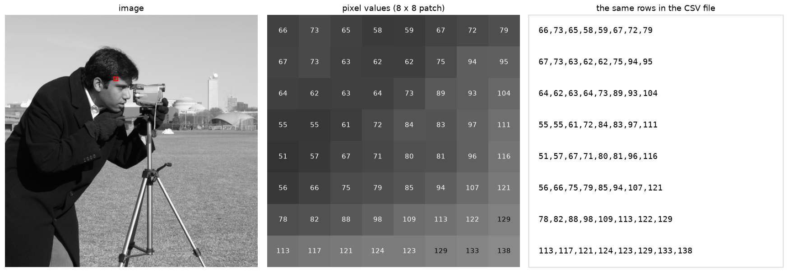

# CSV data to image

[](https://github.com/anupbagale/csv-data-to-image/actions/workflows/ci.yml)
[](LICENSE)

Convert an image to a CSV file of pixel values and turn the CSV file back into the same image.
Works for grayscale and colour images, and the round trip is lossless.



## Command-line tool

`csv_image.py` converts in both directions:

```bash
python csv_image.py to-csv photo.png photo.csv           # image -> CSV
python csv_image.py to-csv photo.png gray.csv --gray     # convert to grayscale first
python csv_image.py to-image photo.csv restored.png      # CSV -> image
```

Each line of the CSV file is one row of the image. A grayscale row is one value per pixel. A
colour row lists the values pixel by pixel as `r,g,b,r,g,b,...`. The first line is a comment with
the image shape, for example `# shape: 512,512,3`, which is needed to rebuild colour images.
Plain CSV files without that line are read as grayscale.

The functions can also be imported:

```python
from csv_image import array_to_csv, csv_to_array

array_to_csv(image, "image.csv")      # image: uint8 array, H x W or H x W x C
image = csv_to_array("image.csv")
```

## Notebooks

| # | Notebook | What it covers | Colab |
|---|---|---|---|
| 1 | [Grayscale image to CSV and back](notebooks/01_image_to_csv.ipynb) | `csv` module, `np.loadtxt`, checking the result, file sizes | [open](https://colab.research.google.com/github/anupbagale/csv-data-to-image/blob/main/notebooks/01_image_to_csv.ipynb) |
| 2 | [Image to CSV with pandas](notebooks/02_image_to_csv_with_pandas.ipynb) | `DataFrame.to_csv`, `read_csv` and two common mistakes | [open](https://colab.research.google.com/github/anupbagale/csv-data-to-image/blob/main/notebooks/02_image_to_csv_with_pandas.ipynb) |
| 3 | [Colour images](notebooks/03_color_images.ipynb) | storing three channels in a CSV file, OpenCV's BGR order | [open](https://colab.research.google.com/github/anupbagale/csv-data-to-image/blob/main/notebooks/03_color_images.ipynb) |

The notebooks use the sample images that come with scikit-image, so nothing has to be
downloaded. The camera image is CC0 and the astronaut image is in the public domain.

## Installation

```bash
git clone https://github.com/anupbagale/csv-data-to-image.git
cd csv-data-to-image
pip install -r requirements.txt
```

## Tests

```bash
pip install pytest nbmake
pytest                          # tests for csv_image.py
pytest --nbmake notebooks/      # runs every notebook
```

## License

[MIT](LICENSE)
